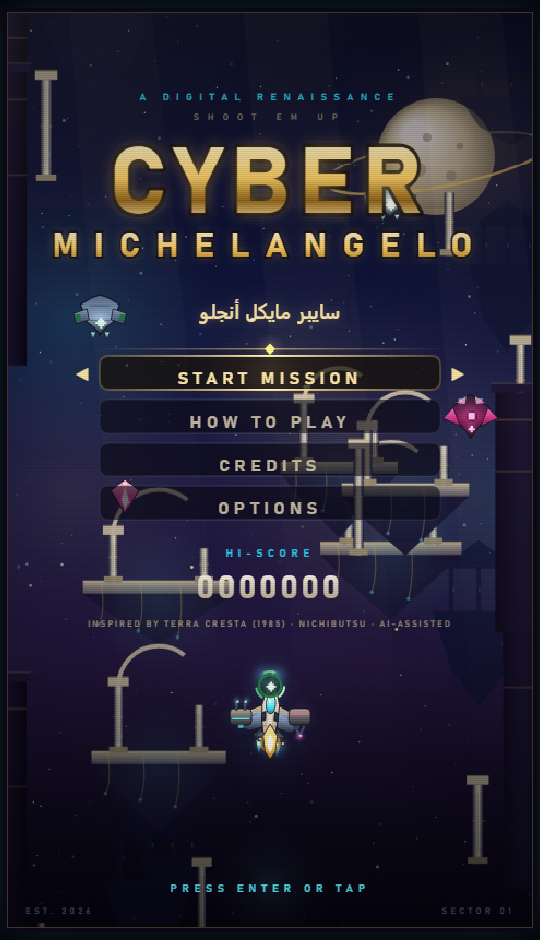
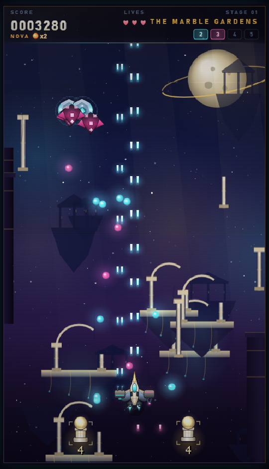
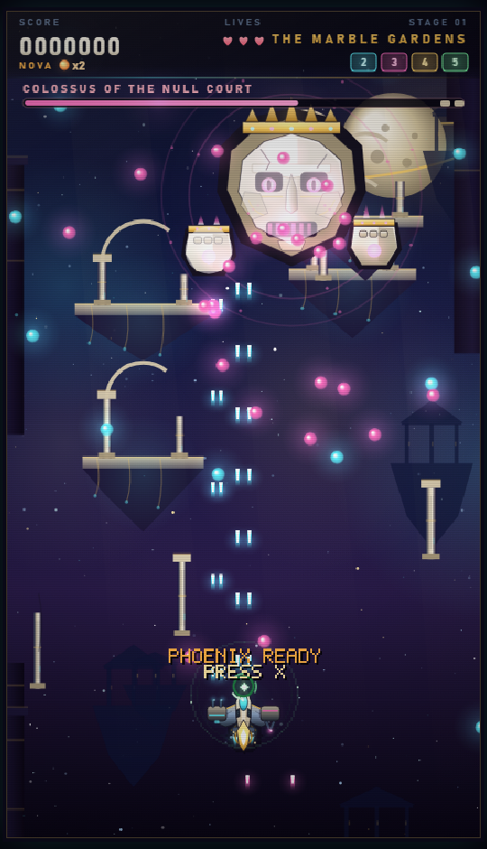
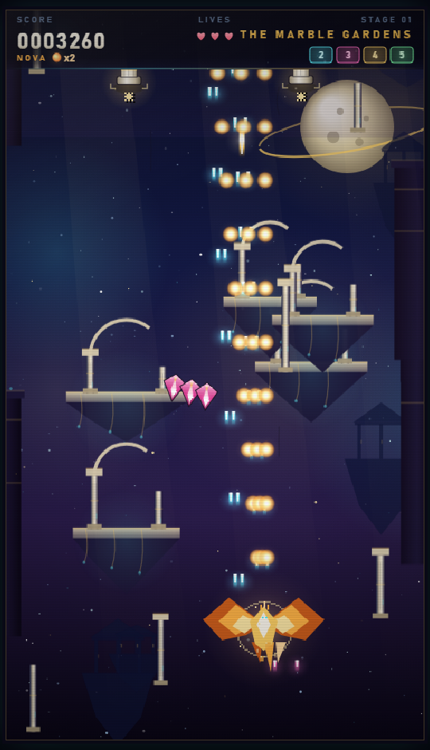
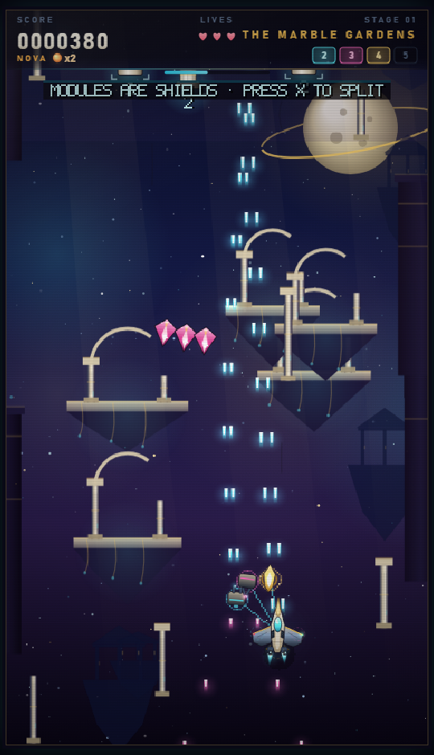
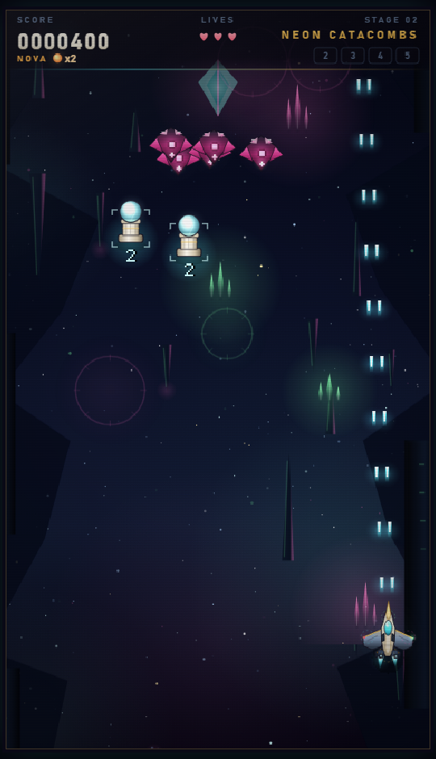
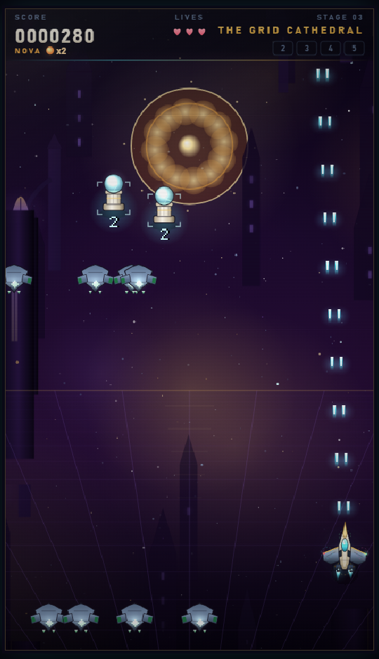

# Cyber Michelangelo · سايبر مايكل أنجلو

**A digital-Renaissance HD-2D vertical shoot 'em up — inspired by *Terra Cresta* (1985), built with AI assistance, zero dependencies.**

لعبة إطلاق نار عمودية بأسلوب **HD-2D**: فن متجهي عالي الدقة فوق خلفيات نهضوية متحركة، مستوحاة من *Terra Cresta* الكلاسيكية، بُنيت بمساعدة الذكاء الاصطناعي وبدون أي مكتبات خارجية.

### ▶ Play the live build · جرّبها الآن

**<https://ly.id.ly/Cyber-Michelangelo/>** — deployed straight from this repository (GitHub Pages mirror).
A Cloudflare Pages deployment with a custom domain is planned next.

### What's new in v1.2 — the HD-2D visual overhaul

- **Device-resolution render pipeline:** the 240×420 gameplay space is now rasterised at 2–4× device scale, so vector ships, gradients and glows stay crisp on every screen and DPR.
- **Redrawn hero craft:** layered armoured wings, glass canopy, gold nose blade, animated engines, banking and visible docking clamps for all four modules.
- **All eight enemies redrawn** in HD vector art (plating, reactor cores, animated engines) plus smooth gradient energy bullets.
- **HD parallax environments** for all three themes: floating temple ruins, bioluminescent catacombs and the rose-window grid cathedral, with atmospheric depth, dust and light rays.
- **HD Colossus boss:** engraved marble war-mask, crown, tracking eyes, floating fists and growing battle damage.
- **Modern HUD, title screen and all menus:** glass panels, gradient typography, vector hearts, module capsules, boss bar and countdown ring — no more bitmap UI.
- **Mechanics untouched:** the same 41 logic tests and 16 in-browser checks stay green.

<details>
<summary>v1.1 changes (kept for history)</summary>

- Readability pass: outlined sprites, brighter weapon cores, stronger enemy eyes, player halo.
- Fairer opening: first pod cluster on wave 1, missed clusters retry next wave, 2 starting NOVA charges, 8.5 s Phoenix, calmer first wave.
- First-run tutorial hint teaches the pod → module loop.

</details>



---

## Play now · شغّل اللعبة

Requires **Node.js 18+** (already installed here). There are **no npm dependencies**, so nothing to install — even offline:

```bash
npm start          # → http://127.0.0.1:5173
```

Then open <http://127.0.0.1:5173> in any modern browser. That's it.

> يتطلب Node.js 18+ فقط، ولا يحتاج أي `npm install` لأنه بدون مكتبات خارجية. شغّل `npm start` ثم افتح الرابط.

### Deploy on Cloudflare Pages (static hosting)

The game is a pure static site — perfect for **Cloudflare Pages** and later a custom domain:

1. Push this repository to GitHub.
2. In the Cloudflare dashboard → **Workers & Pages → Create → Pages → Connect to Git**, choose the `Cyber-Michelangelo` repository.
3. Settings:
   - **Framework preset:** `None`
   - **Build command:** *(leave empty — there is no build step)*
   - **Build output directory:** `/`
4. Deploy. The game is served at `https://<project>.pages.dev`; add a **custom domain** under *Custom domains* whenever you like (Cloudflare manages the TLS certificate automatically).

`_headers` (security/caching headers), `_redirects` (`/play` → `/`), and a themed `404.html` are included. `server.mjs` is only for local development and is not required in production.

#### Deploy without the dashboard (Direct Upload API)

A zero-dependency deploy script is included — ideal for CI or for hosting without connecting GitHub:

```bash
# token needs "Account → Cloudflare Pages → Edit"
export CLOUDFLARE_API_TOKEN=...        # Windows: $env:CLOUDFLARE_API_TOKEN="..."
export CLOUDFLARE_ACCOUNT_ID=...

npm run deploy -- --dry-run   # list the 56 files that will be uploaded
npm run deploy                # creates the Pages project (first run) + deploys
```

It prints the deployment URL (`https://<project>.pages.dev`). Add the custom domain once under **Pages → Custom domains** (Cloudflare creates the DNS record + certificate automatically when the zone is on the same account).

> Why Direct Upload matters here: the current live mirror (`ly.id.ly`) is fronted by Cloudflare's proxy, and GitHub Pages serves JS with a 4-hour `max-age`. Cloudflare Pages respects this repo's `_headers` (`must-revalidate`), so every deploy becomes visible immediately.

---

## Controls · التحكم

| Action | Keyboard | Gamepad | Touch |
| --- | --- | --- | --- |
| Move | `← ↑ → ↓` / `WASD` | Left stick / D-pad | Drag anywhere (relative) |
| Fire | `Z` / `Space` / `J` (hold) | A | Auto-fire while dragging |
| Transform (split / Phoenix) | `X` / `K` / `Shift` | X | `FORM` button |
| Nova bomb | `B` / `L` | B | `NOVA` button |
| Pause | `Esc` / `P` | Start | ⏸ button |
| Mute | `M` | — | — |
| Fullscreen | `F` | — | — |

Menus: `↑ ↓` + `Enter`; `Esc` = back. Auto-fire can also be enabled for keyboard in **Options**.

---

## The game · اللعبة

### 1. Core ship — Alpha Unit
A twin-laser craft with a forgiving 4-pixel core hitbox and a banked, weighty feel.

### 2. Shoot the pods, earn the modules
Ground relics scroll into view in clusters of four. **Destroy every pod in a cluster** to release the module capsule it guards — the cluster carries the number of the piece you still need (`2`, `3`, `4`, `5`). Let the pods scroll past and the **cluster retries on the very next wave**, so a missed cluster never costs a whole stage.

> أطلق النار على الصوامع الأرضية الأربعة في كل مجموعة لتُحرّر كبسولة الوحدة المرقّمة، ثم التقطها لتلتحم بسفينتك — وإذا فوّت مجموعة فستعود في الموجة التالية.

The four modules, each with its own role:

| # | Module | Weapon / role |
| --- | --- | --- |
| 2 | **BETA** — Auxiliary Fire | Twin side cannons; doubles forward fire density |
| 3 | **GAMMA** — Rear Cannon | Downward-outward rear shots cover your six |
| 4 | **DELTA** — Concussive Beam | Periodic piercing lance that shreds big targets |
| 5 | **EPSILON** — Rear Force Field | A green aura that erases enemy bullets near the ship |

Every docked module is also **one absorbed hit**. A hit removes the outermost piece instead of your life — the original's famous modular damage buffer.

### 3. Formation split — the transform key
With **1–3 pieces docked**, press `X` to make the pieces split into a tactical formation around the hull:

- **1 piece → ESCORT** — a halo orbit.
- **2 pieces → MOON** — a crescent guarding the nose.
- **3 pieces → EXTEND** — a sweeping echelon line, "helicopter fire".

While split, the pieces are **invulnerable and fire faster**, but the main hull is **not**. A hit on the hull reverts you to a singular craft and all pieces are lost — risk / reward. The formation auto-rejoins after 3.4 s, then needs a short cooldown.

### 4. Phoenix transformation
Collect **all four pieces**, then press `X`. The craft becomes the **invincible flaming Phoenix** for 8.5 s: it flies faster, clears bullets, destroys enemies by contact, pours out a triple flame stream and doubles score gains. When the fire dies down, the four pieces **burn out** — rebuild by hunting new pod clusters.

### 5. Nova bomb
Start each run with **two** NOVA charges (max 3). Press `B` to erase every enemy bullet on screen, invincibly flash, and deal heavy damage to everything nearby. Charges drop from Goliath gunships, bosses and score milestones.

### 6. Endless looped stages
Five procedural waves per stage, then a boss. Three hand-built environments cycle endlessly:

1. **THE MARBLE GARDENS** — floating classical ruins over a nebula.
2. **THE NEON CATACOMBS** — runed caverns of bioluminescent crystal.
3. **THE GRID CATHEDRAL** — gothic spires above a perspective grid.

Each loop raises enemy HP, bullet speed, fire rate and formation density (`DIFFICULTY` in `src/game/config.js`). Every stage ends with a **Null Court Colossus** — a three-phase marble war-mask with destructible hands, aimed bursts, rings, bullet walls and spirals.

### 7. Scoring
Wave clears, boss kills, pod clusters, Phoenix bonuses and a kill-chain multiplier (up to **×8**, decaying over 2.2 s) feed an arcade score. Extra lives at 30 000, 80 000, 150 000, 250 000, 400 000, 600 000 and 850 000 points. High scores persist in `localStorage`.

---

## Screenshots · لقطات

| Gameplay | Boss |
| --- | --- |
|  |  |

| Phoenix | Formation |
| --- | --- |
|  |  |

| Catacombs | Grid Cathedral |
| --- | --- |
|  |  |

---

## Project structure

```
index.html            page shell (canvas 4:7 portrait cabinet)
styles.css            cabinet framing, boot overlay
server.mjs            zero-dependency static server (node server.mjs)
src/
  main.js             bootstrap: canvas, input, audio, fixed 60 Hz loop, URL test hooks
  core/
    math.js           deterministic RNG, easing, geometry helpers
    storage.js        safe localStorage wrapper + high scores/settings
    input.js          keyboard + gamepad + relative-drag touch
    audio.js          procedural WebAudio chiptune + 30 SFX (no audio files)
  game/
    config.js         all tunables: player, modules, enemies, boss, scoring, difficulty
    formations.js     pure formation choreography
    waves.js          deterministic stage/wave generator (pure)
    player.js         Alpha craft, docking, formation split, Phoenix, damage buffer
    enemies.js        eight enemy behaviours + spawn factories
    boss.js           three-phase Colossus fight
    game.js           DOM-free state machine: scenes, waves, collisions, scoring, lives
  render/
    palette.js        the "digital Renaissance" colour system, three stage themes
    pixel.js          render-buffer primitives, sprite compiler, glow/particle helpers
    pixelfont.js      5×7 bitmap font (legacy pixel UI, kept for reference)
    sprites.js        hand-authored pixel art (legacy, kept for reference)
    background.js     legacy pixel parallax (kept for reference)
    title.js          legacy pixel title (kept for reference)
    hud.js            legacy pixel HUD (kept for reference)
    art_player.js     HD vector hero craft, docking modules, engines, banking
    art_enemies.js    HD vector art for all eight enemy kinds
    art_boss.js       HD Colossus boss: mask, fists, phases, damage states
    art_pickups.js    HD relic pods, module capsules, gems, nova, hearts
    art_background.js prerendered HD parallax environments (all three themes)
    art_title.js      HD title screen with live hero diorama
    ui_hd.js          HD HUD, boss bar, banners, popups, touch controls
    screens.js        HD how-to-play, credits, options, pause, game over
    renderer.js       full renderer + particle/FX system
  ui/touch.js         touch-control layout shared by input & renderer
tests/
  smoke.mjs           41 pure-logic tests (Node, no DOM)
  syntax.mjs          parse-check every source module
tools/capture.ps1     headless-Edge screenshot helper used for visual verification
tools/deploy-cloudflare.mjs  zero-dependency Cloudflare Pages direct upload
docs/GAME_DESIGN.md   full design/technical specification
research/             preserved prior Terra Cresta research report site (reference only)
```

### Architecture in one paragraph
Simulation is a **DOM-free state machine** (`Game`) updated at a fixed 1/60 s step; rendering, audio and visual FX are injected as small interfaces. The renderer keeps gameplay in a **240×420 logical space** but rasterises into a device-resolution buffer (2–4× depending on screen size / DPR) using vector paths, gradients and cached glow sprites. Ships, enemies, boss, pickups and UI are drawn procedurally (`art_*.js`, `ui_hd.js`); environments are prerendered once per theme at device scale and scrolled as parallax layers (`art_background.js`). Audio is synthesised (`audio.js`), and every world is generated from a seeded RNG. This keeps the game deterministic, testable headlessly, asset-free and offline-capable.

---

## Verification · التحقق

```bash
npm test                    # 41 logic tests, all green
node tests/syntax.mjs       # every module parses
```

Browser self-test (renders every scene and asserts canvas output):

```
http://127.0.0.1:5173/?selftest=1&noboot=1     → DOM gets {ok: true, results: [...]}
```

Screenshot helpers used during development (headless Edge):

```
node server.mjs
powershell -File tools/capture.ps1 -Shots "title|?noboot=1;game|?scene=game&sim=26&freeze=1&noboot=1"
```

Debug URL hooks: `?scene=game|boss|phoenix|formation|catacombs|cathedral|gameover|howto|credits|options`, `&sim=SECONDS`, `&freeze=1`, `&touch=1`, `&seed=N`, `&mute=1`, `&fps=1`, `&noscanlines=1`.

---

## Credits & attribution · الشكر والحقوق

- **Inspired by *Terra Cresta*** (Nichibutsu, 1985) — designed by **Shigeki Fujiwara**, music by **Kenji Yoshida**. Its modular power-up and formation-split system is the direct design ancestor of this project.
- Series context: ***Moon Cresta*** (1980), ***Terra Cresta*** (1985), ***Sol Cresta*** (2022, PlatinumGames).
- **Cyber Michelangelo** is an original, non-commercial homage. **No original game code, art, names or audio assets were used** — every pixel and every sound is generated procedurally in this repository.
- Built with **AI assistance** (DeepSeek agent) for design, code, art and audio.
- The `research/` folder preserves an independent Arabic research report on the *Cresta* series that informed the design; it is reference material and is not required to play.

**License:** MIT.

---

## الخلاصة بالعربية

**سايبر مايكل أنجلو** لعبة شوتر عمودية بأسلوب **HD-2D** — فن متجهي عالي الدقة فوق خلفيات نهضوية متحركة — مستوحاة من *Terra Cresta* (1985):
سفينة ألفا الأساسية، وأربع وحدات قتالية (بيتا، غاما، دلتا، إبسيلون) تُحرَّر بإسقاط الصوامع الأرضية وتلتحم بالسفينة فتمنحها قوة نارية إضافية وتمتص الضربات بدلاً منك.
اضغط زر التحويل `X` لتفكيك الوحدات في تشكيلات قتالية مؤقتة (الهلال، التمدد، الحراسة) — القطع منيعة أثناء الانفصال لكن جسم السفينة مكشوف؛ وإذا جمعت القطع الأربع فاضغط `X` لتتحول إلى **طائر العنقاء الناري** الذي لا يُقهر لدقائق. أضف إلى ذلك قنبلة **NOVA** الماسحة للشاشة، ومضاعفات النقاط، وثلاث بيئات متجددة بجرافيك HD، وزعماء مرحلين، وموسيقى ومؤثرات مولّدة رقمياً. تعمل اللعبة بالكامل بدون إنترنت وبدون أي مكتبات، ومختبَرة بـ 41 اختباراً منطقياً وفحوصات بصرية آلية.
